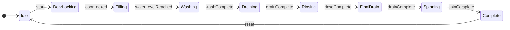

# جلسه اول: مدل‌سازی سیستم گسسته و ماشین حالت ساده

## ۱. هدف تمرین
هدف این تمرین، مدل‌سازی رفتار اصلی ماشین لباسشویی هوشمند با استفاده از ماشین حالت متناهی (FSM) است. در این مدل، مراحل اصلی شست‌وشو و شرایط انتقال بین آن‌ها مشخص می‌شوند.

## ۲. تعریف سیستم گسسته
سیستم کنترل ماشین لباسشویی یک سیستم گسسته در نظر گرفته می‌شود؛ زیرا رفتار آن با مجموعه‌ای از حالت‌های مشخص و انتقال بین آن‌ها مدل می‌شود.

برای مثال، سیستم پس از دریافت فرمان شروع، از حالت آماده‌به‌کار به مرحله قفل‌کردن درب منتقل می‌شود. پس از تأیید قفل و رسیدن آب به سطح موردنظر، مرحله شست‌وشو آغاز می‌شود.

## ۳. تعریف رسمی ماشین حالت
ماشین حالت متناهی با پنج‌تایی زیر تعریف می‌شود:

M = (I, O, S, T, s0)

- I: مجموعه ورودی‌های سیستم
- O: مجموعه خروجی‌های سیستم
- S: مجموعه حالت‌های سیستم
- T: رابطه انتقال بین حالت‌ها
- s0: حالت اولیه سیستم

### ۳.۱. ورودی‌ها
- start: فرمان شروع
- doorClosed: بسته‌بودن درب
- doorLocked: تأیید قفل درب
- waterLevelReached: رسیدن آب به سطح موردنظر
- washComplete: پایان شست‌وشو
- drainComplete: پایان تخلیه
- rinseComplete: پایان آبکشی
- spinComplete: پایان دور تند
- reset: فرمان بازنشانی

### ۳.۲. خروجی‌ها
- doorLock: فرمان قفل درب
- waterInletValve: فرمان شیر ورودی آب
- drainPump: فرمان پمپ تخلیه
- washMotor: فرمان موتور شست‌وشو
- spinMotor: فرمان موتور دور تند
- alarm: هشدار خطا

### ۳.۳. حالت‌ها
- Idle: آماده‌به‌کار
- DoorLocking: قفل‌کردن درب
- Filling: ورود آب
- Washing: شست‌وشو
- Draining: تخلیه آب
- Rinsing: آبکشی
- FinalDrain: تخلیه نهایی
- Spinning: دور تند
- Complete: پایان چرخه

## ۴. نمودار ماشین حالت ساده

## ۵. جدول انتقال حالت

| حالت فعلی | ورودی یا رویداد | حالت بعدی |
|---|---|---|
| Idle | start | DoorLocking |
| DoorLocking | doorLocked | Filling |
| Filling | waterLevelReached | Washing |
| Washing | washComplete | Draining |
| Draining | drainComplete | Rinsing |
| Rinsing | rinseComplete | FinalDrain |
| FinalDrain | drainComplete | Spinning |
| Spinning | spinComplete | Complete |
| Complete | reset | Idle |

## ۶. توضیح عملکرد
۱. سیستم در حالت آماده‌به‌کار قرار دارد.
۲. با دریافت فرمان شروع، فرایند قفل‌کردن درب آغاز می‌شود.
۳. پس از تأیید قفل، شیر ورودی آب فعال می‌شود.
۴. پس از رسیدن آب به سطح موردنظر، شست‌وشو آغاز می‌شود.
۵. بعد از پایان شست‌وشو، آب تخلیه می‌شود.
۶. سیستم مرحله آبکشی و سپس تخلیه نهایی را اجرا می‌کند.
۷. پس از آن، مرحله دور تند انجام می‌شود.
۸. در پایان، سیستم وارد حالت پایان چرخه می‌شود.

## ۷. نتیجه‌گیری
در این تمرین، ماشین لباسشویی هوشمند با یک ماشین حالت متناهی مدل‌سازی شد. حالت‌های اصلی، ورودی‌ها، خروجی‌ها و انتقال بین حالت‌ها مشخص شدند. در جلسه دوم، این مدل با متغیرهای حالت، شرط‌های نگهبان، اکشن‌ها و تایمر توسعه داده می‌شود.

