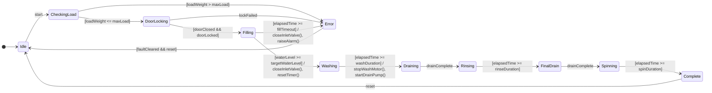

# جلسه دوم: ماشین حالت توسعه‌یافته و مدیریت زمان

## ۱. هدف تمرین
در این جلسه، ماشین حالت ساده جلسه اول توسعه داده می‌شود. در مدل جدید، متغیرهای حالت، شرط‌های نگهبان، اکشن‌ها و تایمر برای کنترل دقیق‌تر چرخه شست‌وشو استفاده می‌شوند.

## ۲. متغیرهای حالت
متغیرهای زیر برای نگهداری اطلاعات داخلی سیستم تعریف می‌شوند:

| نام متغیر | نوع | کاربرد |
|---|---|---|
| loadWeight | عددی | نگهداری وزن لباس‌ها |
| waterLevel | عددی | نگهداری سطح آب |
| elapsedTime | زمانی | مدت سپری‌شده از شروع مرحله |
| selectedProgram | دسته‌ای | برنامه انتخاب‌شده شست‌وشو |

ظرفیت مجاز لباس‌ها با متغیر maxLoad و مدت هر مرحله با متغیرهایی مانند washDuration و fillTimeout مشخص می‌شود. مقدار واقعی این پارامترها باید براساس مشخصات دستگاه تعیین شود.

## ۳. شرط‌های نگهبان (Guards)
شرط نگهبان، شرطی است که برقرار بودن آن برای انجام یک انتقال ضروری است.

- [loadWeight <= maxLoad]: وزن لباس‌ها در محدوده مجاز است.
- [doorClosed && doorLocked]: درب بسته است و قفل آن تأیید شده است.
- [waterLevel >= targetWaterLevel]: آب به سطح هدف رسیده است.
- [elapsedTime >= washDuration]: زمان شست‌وشو به پایان رسیده است.
- [elapsedTime >= fillTimeout]: زمان مجاز ورود آب به پایان رسیده است.

## ۴. اکشن‌ها (Actions)
- lockDoor(): ارسال فرمان قفل درب
- openInletValve(): بازکردن شیر ورودی آب
- closeInletValve(): بستن شیر ورودی آب
- startWashMotor(): شروع موتور شست‌وشو
- startDrainPump(): شروع پمپ تخلیه
- resetTimer(): صفرکردن تایمر مرحله
- raiseAlarm(): فعال‌کردن هشدار

## ۵. مدیریت تایمر
با ورود به هر مرحله زمان‌دار، تایمر مرحله صفر می‌شود. با گذشت زمان، مقدار elapsedTime افزایش می‌یابد.

برای مثال، اگر زمان شست‌وشو به washDuration برسد، سیستم از حالت Washing به حالت Draining منتقل می‌شود.

اگر زمان ورود آب از fillTimeout عبور کند و سطح آب هدف حاصل نشود، سیستم باید شیر ورودی را ببندد و خطا اعلام کند.

## ۶. نمودار ماشین حالت توسعه‌یافته

## ۷. جدول انتقال‌های توسعه‌یافته

| حالت فعلی | شرط یا رویداد | حالت بعدی | اکشن |
|---|---|---|---|
| Idle | start | CheckingLoad | بررسی وزن |
| CheckingLoad | وزن مجاز | DoorLocking | درخواست قفل |
| CheckingLoad | وزن غیرمجاز | Error | اعلام خطا |
| DoorLocking | درب بسته و قفل تأیید شده | Filling | بازکردن شیر آب |
| Filling | سطح آب به هدف رسیده | Washing | بستن شیر و صفرکردن تایمر |
| Filling | پایان مهلت ورود آب | Error | بستن شیر و هشدار |
| Washing | پایان زمان شست‌وشو | Draining | توقف موتور و شروع تخلیه |
| Draining | drainComplete | Rinsing | آغاز آبکشی |
| Rinsing | پایان زمان آبکشی | FinalDrain | شروع تخلیه نهایی |
| FinalDrain | drainComplete | Spinning | درخواست شروع دور تند |
| Spinning | پایان زمان دور تند | Complete | توقف موتور دور تند |
| Complete | reset | Idle | بازگشت به آماده‌به‌کار |

## ۸. نتیجه‌گیری
در این جلسه، ماشین حالت ساده به ماشین حالت توسعه‌یافته تبدیل شد. متغیرها اطلاعات داخلی سیستم را نگهداری می‌کنند، شرط‌های نگهبان انتقال‌های مجاز را مشخص می‌کنند و تایمرها امکان کنترل مدت اجرای مراحل را فراهم می‌سازند.

