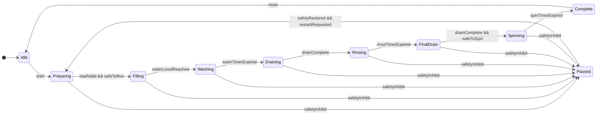
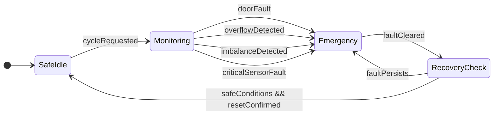

# جلسه سوم: ترکیب ماشین‌های حالت

## ۱. هدف تمرین

هدف این جلسه، تقسیم سیستم کنترل ماشین لباسشویی هوشمند به دو ماشین حالت مستقل و بررسی نحوه تعامل آن‌ها است.

ماشین اول مسئول مدیریت چرخه شست‌وشو است و ماشین دوم شرایط ایمنی را پایش می‌کند. این ساختار باعث می‌شود عملکرد عادی دستگاه از منطق کنترل شرایط اضطراری جدا باشد.

## ۲. ماشین حالت عملیاتی

ماشین حالت عملیاتی، مراحل عادی شست‌وشو را کنترل می‌کند.

حالت‌های اصلی عبارت‌اند از:

- Idle: آماده‌به‌کار
- Preparing: بررسی اولیه شرایط
- Filling: ورود آب
- Washing: شست‌وشو
- Draining: تخلیه آب
- Rinsing: آبکشی
- FinalDrain: تخلیه نهایی
- Spinning: دور تند
- Complete: پایان چرخه
- Paused: توقف کنترل‌شده عملیات

### ۲.۱. نمودار ماشین حالت عملیاتی

## ۳. ماشین حالت ایمنی

ماشین حالت ایمنی، وضعیت حسگرهای مهم را پایش می‌کند و در صورت شناسایی شرایط خطرناک، مانع ادامه عملکرد عادی می‌شود.

حالت‌های اصلی آن عبارت‌اند از:

- SafeIdle: آماده پایش
- Monitoring: پایش شرایط ایمنی
- Emergency: وضعیت اضطراری
- RecoveryCheck: بررسی شرایط پس از رفع خطا

### ۳.۱. نمودار ماشین حالت ایمنی

## ۴. ترکیب ماشین‌های حالت

دو ماشین حالت با استفاده از سیگنال‌های مشترک با یکدیگر ارتباط برقرار می‌کنند.

| سیگنال | تولیدکننده | کاربرد |
|---|---|---|
| safetyInhibit | ماشین ایمنی | جلوگیری از ادامه عملکرد عادی |
| safeToRun | ماشین ایمنی | اجازه اجرای مراحل مجاز |
| safeToSpin | ماشین ایمنی | اجازه شروع دور تند |
| faultCleared | منطق پایش ایمنی | اعلام برطرف‌شدن خطا |
| resetConfirmed | ورودی کاربر | تأیید بازنشانی پس از رفع خطا |

سیگنال safetyInhibit زمانی فعال می‌شود که ماشین ایمنی ادامه عملکرد عادی را مجاز نداند. سیگنال safeToSpin نیز برای جلوگیری از شروع دور تند در شرایط ناایمن استفاده می‌شود.

## ۵. ترکیب همزمان و ناهمزمان

### ۵.۱. ترکیب همزمان

در ترکیب همزمان، ماشین‌های حالت در یک چارچوب منطقی مشترک، ورودی‌ها و سیگنال‌های کنترلی را در گام‌های مشخص بررسی می‌کنند.

برای مثال، قبل از شروع دور تند، وضعیت مجازبودن این عملیات بررسی می‌شود.

### ۵.۲. ترکیب ناهمزمان

در ترکیب ناهمزمان، ماشین ایمنی می‌تواند در پاسخ به یک رویداد حسگر، مانند تشخیص سرریز آب، مستقل از زمان‌بندی مراحل عادی شست‌وشو واکنش نشان دهد.

### ۵.۳. ترکیب سلسله‌مراتبی

در یک مدل سلسله‌مراتبی، می‌توان حالت کلی Running را به زیرحالت‌هایی مانند Filling، Washing، Rinsing و Spinning تقسیم کرد. این کار از تکرار منطق مشترک جلوگیری می‌کند و ساختار نمودار را خواناتر می‌سازد.

## ۶. حالت‌های ایمنی

رفتار مورد انتظار سیستم در شرایط خطرناک به شرح زیر است:

| وضعیت | واکنش مورد انتظار |
|---|---|
| خطای قفل درب | جلوگیری از شروع و مهار حرکت خطرناک درام |
| سرریز آب | قطع فرمان ورود آب و اعلام هشدار |
| عدم تعادل بار | جلوگیری از ادامه دور تند |
| خرابی حسگر حیاتی | جلوگیری از اجرای مرحله وابسته به حسگر |
| رفع خطا | بررسی مجدد شرایط و انتظار برای تأیید بازنشانی |

در یک پیاده‌سازی واقعی، توقف موتور، کنترل قفل درب و فرمان پمپ باید براساس نوع خطا و طراحی ایمنی دستگاه انجام شوند. همچنین بازگشت از وضعیت اضطراری فقط پس از رفع خطا و تأیید شرایط ایمن مجاز است.

## ۷. نتیجه‌گیری

در این جلسه، سیستم کنترل ماشین لباسشویی هوشمند به دو ماشین حالت عملیاتی و ایمنی تقسیم شد. ماشین عملیاتی مراحل شست‌وشو را مدیریت می‌کند و ماشین ایمنی شرایط خطرناک را پایش می‌کند.

این تفکیک، مدل‌سازی رفتار عادی و واکنش به خطاها را ساده‌تر می‌کند و نمونه‌ای از کاربرد ترکیب ماشین‌های حالت در یک سیستم سایبرفیزیکی است.

